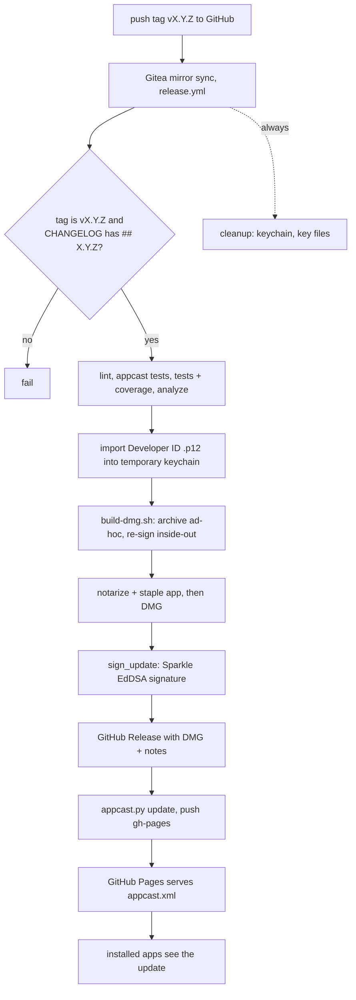

# Auto-update and releases

VSVibe updates itself with **Sparkle 2** (Swift Package). Releases are built by
Gitea Actions from a `vX.Y.Z` tag: a Developer ID signed, notarized and stapled
DMG is published as a GitHub Release asset, and an entry is added to the Sparkle
appcast at `https://mc231.github.io/vsvibe/appcast.xml` (`gh-pages` branch).

One-time owner setup (certificate export, API key, Sparkle key, token, Pages):
[`scripts/NOTARIZE.md`](../scripts/NOTARIZE.md).

## User view

- **VSVibe → Check for Updates…** (app menu, after "About VSVibe";
  `UI/App/CheckForUpdatesButton.swift`). Disabled while Sparkle cannot start a
  check (e.g. one is already running).
- **Settings → Updates** (`UI/Settings/UpdatesSettingsTab.swift`):
  - "Automatically check for updates";
  - "Automatically download and install updates" (disabled while automatic
    checks are off; Sparkle derives it from automatic checks);
  - "Current version", e.g. `Version 0.2.0 (123)`;
  - **Check Now**.
- Updates use **Sparkle's standard dialog**: release notes (the CHANGELOG
  section, as HTML) and Install Update / Remind Me Later / Skip This Version.
- **Relaunch confirmation.** Installing relaunches the app, which closes every
  pane. `RelaunchGuard` asks first **only when panes would be lost**: the count
  is `SessionRestoreSettings.sessionsLostOnRelaunch(running:)`, which is `0`
  when "Restore sessions on launch" is on and the number of running panes when
  it is off. The alert "Install the update and relaunch VSVibe?" offers
  **Install and Relaunch** or **Later**; Later postpones the relaunch and the
  update installs when the user quits VSVibe. With restore on there is no
  prompt; panes come back after the relaunch (see
  [session-restore.md](session-restore.md)).

## App architecture (`VSVibe/Updates/`)

| Type | Role | Coverage |
| --- | --- | --- |
| `AppUpdating` | Protocol: `canCheckForUpdatesPublisher`, `automaticallyChecksForUpdates`, `automaticallyDownloadsUpdates`, `checkForUpdates()`. Faked in tests (`VSVibeTests/FakeUpdater.swift`). | n/a |
| `UpdateViewModel` | `@Observable` state for the menu item and Updates tab; version string from `CFBundleShortVersionString` + `CFBundleVersion`. | tested |
| `RelaunchGuard` | Builds the confirmation prompt and decides whether to postpone the relaunch. | tested |
| `UpdaterLaunchPolicy` | `shouldStartUpdater` is false inside the unit-test host (`XCTestConfigurationFilePath`), so tests never check for updates. | tested |
| `SparkleUpdater` | `AppUpdating` over `SPUStandardUpdaterController`; owns the delegate (Sparkle holds it weakly). | excluded (glue) |
| `SparkleUpdaterDelegate` | `SPUUpdaterDelegate.updater(_:shouldPostponeRelaunchForUpdate:untilInvokingBlock:)` shows the `RelaunchGuard` prompt as an `NSAlert`. | excluded (glue) |

Wiring: `VSVibeApp.init` creates `SparkleUpdater` with a closure returning
`sessionsLostOnRelaunch(running: sessionManager.sessions.count)` and wraps it in
`UpdateViewModel`, which is passed to the menu command and `SettingsView`.

### Info.plist (from `project.yml`)

| Key | Value |
| --- | --- |
| `SUFeedURL` | `https://mc231.github.io/vsvibe/appcast.xml` |
| `SUPublicEDKey` | Public half of the Sparkle EdDSA key (safe to commit). Sparkle rejects any update whose DMG signature does not verify against it. |
| `SUEnableAutomaticChecks` | `true` (no first-launch permission prompt). |
| `CFBundleShortVersionString` | `$(MARKETING_VERSION)` |
| `CFBundleVersion` | `$(CURRENT_PROJECT_VERSION)` |

### Versioning

- `MARKETING_VERSION` = the tag without `v` (`v0.2.0` → `0.2.0`), passed to
  `xcodebuild` by `scripts/build-dmg.sh`.
- `CURRENT_PROJECT_VERSION` = `git rev-list --count HEAD` (build number). Sparkle
  compares this (`sparkle:version`), so it must grow with every release; the
  workflow checks out full history (`fetch-depth: 0`) for it.
- The values in `project.yml` (`0.2.0` / `1`) are only local defaults.

## Release pipeline

`.gitea/workflows/release.yml` runs on the self-hosted macOS runner when a
`v*` tag arrives through the Gitea pull-mirror of GitHub. It never pushes to
`main` or to the mirror.

1. **Version and notes.** Tag must match `^v[0-9]+\.[0-9]+\.[0-9]+$`.
   `tools/appcast.py notes X.Y.Z` extracts the `## [X.Y.Z]` section of
   `CHANGELOG.md` and **fails if it is missing or empty**. Build number =
   commit count. DMG name `VSVibe-X.Y.Z.dmg`.
2. **Quality gates.** `tools/lint.sh`, the appcast tool tests
   (`tools/test_appcast.py`), `tools/test.sh` (build, tests, ≥90% coverage),
   `tools/lint.sh --analyze`.
3. **Temporary keychain.** The `.p12` is decoded into `$RUNNER_TEMP`, imported
   into a new keychain with a random password, added to the user search list
   (the original list is saved and restored), and the Developer ID Application
   identity is located. The login keychain is never used.
4. **ASC API key.** The `.p8` is written to `$RUNNER_TEMP` (mode 600) for
   `notarytool`.
5. **Build, sign, notarize, staple** (`NOTARIZE=1 scripts/build-dmg.sh`):
   - `xcodegen generate`, then `xcodebuild archive` (Release, ad-hoc) with
     `MARKETING_VERSION` / `CURRENT_PROJECT_VERSION`; derived data in
     `build/dd-release`.
   - Re-sign **inside-out** with hardened runtime and secure timestamp, no
     `--deep`: Sparkle's `Installer.xpc`, `Downloader.xpc` (entitlements
     preserved), `Autoupdate`, `Updater.app`, `Sparkle.framework`, other
     frameworks, then the app (which drops Xcode's `get-task-allow`).
   - Pass 1: zip the app, `notarytool submit --key/--key-id/--issuer --wait`,
     staple the app.
   - Pass 2: build the DMG from the stapled app, sign it, notarize, staple.
   - Verify: `stapler validate` (app and DMG), `spctl --assess`.
6. **Sparkle signature.** `scripts/sparkle-tool.sh sign_update build/dd-release`
   finds Sparkle's `sign_update` in the SPM artifacts; it signs the DMG with the
   EdDSA private key, the output's `length` is checked against the file size,
   and the signature is verified before use.
7. **Artifact.** The DMG is also uploaded as a Gitea artifact (90 days).
8. **GitHub Release** (`gh`, `GH_RELEASE_TOKEN`): created with
   `--verify-tag`, title `VSVibe X.Y.Z`, CHANGELOG section as notes. A re-run
   of the same tag replaces the asset and notes.
9. **Appcast.** Shallow-clones `gh-pages` (or creates it as an orphan branch),
   runs `tools/appcast.py update` (one `<item>`: `sparkle:version` = build,
   `sparkle:shortVersionString` = version, `minimumSystemVersion` 15.0, notes as
   HTML, enclosure URL/length/`sparkle:edSignature`; items sorted newest build
   first; a re-run replaces the item and keeps its `pubDate`), adds
   `.nojekyll`, commits and pushes. The token is passed as an HTTP header, never
   stored in a remote URL or `.git/config`. `ci.yml` ignores `gh-pages`.
10. **Cleanup** (always): restores the keychain search list, deletes the
    temporary keychain, securely removes the `.p12`, `.p8` and Sparkle key.

## How to cut a release

- [ ] Add a non-empty `## [X.Y.Z]` section to `CHANGELOG.md` (move items out
      of `[Unreleased]`). It becomes the GitHub release notes and the in-app
      update notes.
- [ ] Optional local check: `python3 -I tools/appcast.py notes X.Y.Z`.
- [ ] Run `tools/lint.sh && tools/test.sh && tools/lint.sh --analyze`.
- [ ] Commit to `main` and push `main` to GitHub.
- [ ] `git tag vX.Y.Z && git push origin vX.Y.Z`.
- [ ] Watch the "Release" run in Gitea (the mirror syncs every 10 min, or sync
      it manually).
- [ ] Check the GitHub Release and that
      `https://mc231.github.io/vsvibe/appcast.xml` lists the version.

Re-running the workflow for the same tag is safe.

## Secrets

Gitea → repository `vsvibe` → Settings → Actions → Secrets. Values are never
committed; how to produce each one is in `scripts/NOTARIZE.md`.

| Secret | Purpose |
| --- | --- |
| `DEVELOPER_ID_P12_BASE64` | Developer ID Application certificate + private key (`.p12`, base64) for code signing. |
| `DEVELOPER_ID_P12_PASSWORD` | Export password of that `.p12`. |
| `ASC_API_KEY_ID` | App Store Connect API key id, for `notarytool`. |
| `ASC_API_ISSUER_ID` | App Store Connect issuer id, for `notarytool`. |
| `ASC_API_KEY_P8_BASE64` | App Store Connect API private key (`.p8`, base64). |
| `SPARKLE_ED_PRIVATE_KEY` | Sparkle EdDSA private key; signs each DMG for the appcast. |
| `GH_RELEASE_TOKEN` | Fine-grained GitHub token, Contents read/write on `Mc231/vsvibe`: creates releases, uploads DMGs, pushes `gh-pages`. |

- **Backups** of the certificate, API key and Sparkle key live in the owner's
  `~/pet/secure/vsvibe/`. The local `.secrets/` directory is git-ignored and
  must never be committed or printed.
- **Losing the Sparkle private key means installed apps can never update
  again**: they only accept updates signed by the key matching their
  `SUPublicEDKey`, and a new key cannot be shipped through Sparkle.
- **Certificate:** "Developer ID Application: Volodymyr Shyrochuk (M3FHKUJ7Z3)",
  created 2026-11-14, expires 2027-12-14. To renew: create a new Developer ID
  Application certificate, export a new `.p12`, update
  `DEVELOPER_ID_P12_BASE64` and `DEVELOPER_ID_P12_PASSWORD`, and back it up.
  The team id and identity name in `scripts/build-dmg.sh` stay the same.
- `GH_RELEASE_TOKEN` has an expiry; rotate it before it lapses.

## Troubleshooting

| Symptom | Cause / fix |
| --- | --- |
| Run fails at "Version, build number and release notes" with `CHANGELOG has no '## [X.Y.Z]' section` (or `is empty`) | Add the section, commit, then move the tag: delete it locally and on GitHub, re-tag the new commit, push again. |
| `tag … is not vX.Y.Z` | Only plain `vMAJOR.MINOR.PATCH` tags are released. |
| `no Developer ID Application identity` | The `.p12` lacks the private key or is the wrong certificate type, or it expired. Re-export (see renewal above). |
| Notarization rejected (`notarytool … status: Invalid`) | Run `xcrun notarytool log <submission-id> --key … --key-id … --issuer …` locally. Usual causes: an unsigned or ad-hoc nested binary (a new framework not covered by the inside-out loop), missing hardened runtime or timestamp, `get-task-allow` present. Fix signing in `scripts/build-dmg.sh`. |
| Notarization auth error | `ASC_API_*` secrets wrong, or the key was revoked in App Store Connect. |
| `stapler validate` / `spctl` fails | Notarization did not finish or the ticket is not yet available; re-run the job. |
| `Sparkle tool 'sign_update' not found` | Packages not resolved in `build/dd-release`; the build step must run first. |
| `unexpected sign_update output` | Malformed `SPARKLE_ED_PRIVATE_KEY` (must be the one-line `generate_keys -x` export). |
| App reports an update but refuses it ("improperly signed" / signature mismatch) | `SPARKLE_ED_PRIVATE_KEY` does not match `SUPublicEDKey` in the installed build, or the DMG was replaced after signing. Restore the original key from the backup and re-run the release. Never change `SUPublicEDKey` casually. |
| App never sees new versions | Check `https://mc231.github.io/vsvibe/appcast.xml` loads. Pages must be enabled (Settings → Pages → branch `gh-pages`, `/`), which requires the repository to be public on a free plan. Check the item's `sparkle:version` is larger than the installed `CFBundleVersion`. |
| Appcast push fails | `GH_RELEASE_TOKEN` expired or lacks Contents: write. |
