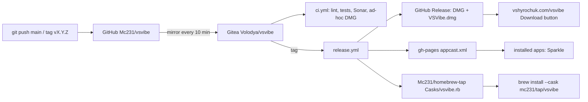

# Distribution, CI and updates: the whole map

Use this page when something about building, testing, releasing, updating or
installing VSVibe needs attention, so you don't have to work out again how the
pieces fit together. Details live in:

- [auto-update-and-releases.md](auto-update-and-releases.md): Sparkle, the release workflow step by step, secrets, troubleshooting.
- [`scripts/NOTARIZE.md`](../scripts/NOTARIZE.md): one-time signing, notarization, Sparkle key and token setup.
- `.claude/skills/release/SKILL.md`: the `/release` procedure, used to cut a release.

## Where everything lives

| Piece | Location | Notes |
| --- | --- | --- |
| Source of truth | GitHub `Mc231/vsvibe` (public), branch `main` | You only push here. |
| CI | Gitea `http://localhost:3001/Volodya/vsvibe` | A **pull-mirror** of GitHub, synced every 10 min. It is read-only: CI never pushes back to it. |
| Runner | Self-hosted act_runner on this Mac, label `macos` | **Capacity 1, shared** with the other repos, so a run sitting in `queued` is normal. |
| Quality gate | SonarQube `http://localhost:9000`, project `vsvibe`, profile and gate "VSVibe strict" | Scanned on `main` only. |
| Releases | GitHub Releases of `Mc231/vsvibe` | Assets `VSVibe-X.Y.Z.dmg` and `VSVibe.dmg` (the stable name). |
| Stable download link | `https://github.com/Mc231/vsvibe/releases/latest/download/VSVibe.dmg` | Used by the website and the README. |
| Update feed | `https://mc231.github.io/vsvibe/appcast.xml` | `gh-pages` branch, served by GitHub Pages. |
| Homebrew | Tap `Mc231/homebrew-tap`, file `Casks/vsvibe.rb` | `brew install --cask mc231/tap/vsvibe`. |
| Website | `https://vshyrochuk.com/vsvibe/`; source `~/pet/quiz_apps/web/landing/vsvibe/index.html` (+ `style.css`) | Firebase Hosting project `landing-1a3d7`. **Not** `~/pet/web/landing`, which is stale. |
| Secrets | Gitea repo secrets; local copies in git-ignored `.secrets/`; backups in `~/pet/secure/vsvibe/` | Never print them, never commit them. |



## CI (`.gitea/workflows/ci.yml`)

It runs on every push to every branch except `gh-pages`:

1. **static**: SwiftLint (every rule, `--strict`), shellcheck, actionlint, the
   tool tests (`python3 -I -m unittest discover -s tools -p 'test_*.py'`,
   covering the appcast, CHANGELOG and Homebrew cask), and gitleaks on the
   pushed commit.
2. **test** (needs static): `tools/test.sh` does a clean build, runs the unit
   tests and enforces at least 90% line coverage on the testable core. Then
   `tools/lint.sh --analyze` runs `swiftlint analyze` and Periphery. On `main`
   it also runs `tools/sonar_scan.sh`, which waits for the Sonar gate.
3. **dmg** (`main` only): an ad-hoc signed DMG artifact, for trying a build;
   it is not for users.

Before pushing, run the same gates locally:
`tools/lint.sh && tools/test.sh && tools/lint.sh --analyze`.

### Checking CI

The `gitea` skill (`~/.claude/skills/gitea/scripts/gitea.py`) does all of this:

```sh
G=~/.claude/skills/gitea/scripts/gitea.py
python3 $G sync vsvibe --expect-local ~/pet/vsvibe/vsvibe   # don't wait 10 min for the mirror
python3 $G runs vsvibe --limit 5
python3 $G logs vsvibe <job-id> --grep "error|FAILED|❌"
python3 $G wait vsvibe <run-id>
```

Raw job logs are on disk:
`~/gitea/data/actions_log/Volodya/vsvibe/<xx>/<task>.log.zst`. Read one with
`zstd -dc FILE | sed 's/\x1b\[[0-9;]*m//g'`.

### CI gotchas

- **Re-running a red commit:** a run started from the UI or a
  `workflow_dispatch` does **not** write a commit status. The red ❌ on the
  commit and the repo page stays even when the re-run is green. To turn the
  commit green, push a new commit (for example `git commit --allow-empty -m
  "Re-run CI"`).
- **Flaky test-process crash:** a run once failed with a crash in
  `SessionManagerRestoreTests.testRestoreSessionTypesTheCommandAndCarriesTheID`,
  while xcodebuild re-ran the remaining tests and reported "TEST FAILED". It
  didn't reproduce in 60 local iterations. If it comes back, keep the full log
  and the crash report.
- **zsh and URLs:** quote any URL containing `?` in shell commands, or zsh
  fails with "no matches found".
- **Sonar down:** `tools/sonar_scan.sh` fails closed. Set `SONAR_REQUIRED=0` to
  skip it on purpose. Fix security hotspots in code; never mark them safe.
- `actions/upload-artifact@v3` is intentional: Gitea speaks its protocol, and
  actionlint's complaint about it is ignored in `ci.yml`.

## Releases (`.gitea/workflows/release.yml`)

A pushed `vX.Y.Z` tag runs the release. Use `/release`, which covers version
choice, CHANGELOG, gates, CI wait, tag and verification. In short:

1. `CHANGELOG.md` needs a non-empty `## [X.Y.Z]` section, or the run fails at
   once. That section becomes the release notes in GitHub and in the update
   dialog.
2. The workflow runs the full gates again. It signs with Developer ID from a
   temporary keychain, notarizes with the App Store Connect API key, and
   staples the app and the DMG.
3. It signs the DMG for Sparkle (EdDSA) and creates the GitHub Release with
   both DMG names.
4. It adds an `<item>` to `appcast.xml` on `gh-pages`.
5. It writes `Casks/vsvibe.rb` to `Mc231/homebrew-tap`.

Every step is idempotent, so you can re-run the job for the same tag. The
version comes from the tag. The build number is `git rev-list --count HEAD`;
Sparkle compares build numbers, so a new release must be on a later commit.

## Auto-update (Sparkle 2)

- The app reads `SUFeedURL` (the appcast) and only accepts DMGs signed with the
  EdDSA key matching `SUPublicEDKey` in `project.yml`. **If the Sparkle private
  key is lost, installed apps can never update again.** Backup:
  `~/pet/secure/vsvibe/`.
- Users get: automatic checks, "Check for Updates…" in the app menu, and
  Settings → Updates. Installing relaunches the app. With session restore on,
  panes come back.
- If a new version doesn't show up, check that the appcast URL serves the new
  item and that its `sparkle:version` (build) is higher than the installed
  `CFBundleVersion`.

## Homebrew

Users install with:

```sh
brew install --cask mc231/tap/vsvibe   # taps Mc231/homebrew-tap automatically
brew uninstall --cask vsvibe           # --zap also removes settings and data
```

- **The tap** is the GitHub repo `Mc231/homebrew-tap`. Homebrew maps
  `mc231/tap` to `github.com/Mc231/homebrew-tap`, so the repo name must keep
  the `homebrew-` prefix. It holds `Casks/vsvibe.rb` and a README.
- **The cask is generated** by `tools/homebrew_cask.py`, tested by
  `tools/test_homebrew_cask.py`. Only the version and SHA-256 change between
  releases. Everything else is the script's template:
  - URL `…/releases/download/vX.Y.Z/VSVibe-X.Y.Z.dmg`;
  - `depends_on macos: :sequoia` (macOS 15 or later);
  - `auto_updates true`;
  - `livecheck` from the appcast (`strategy :sparkle`);
  - `zap` paths for Application Support, Preferences, Caches, HTTPStorages and
    Saved Application State (bundle id `com.shyrochuk.vsvibe`).

  To change the cask, edit the template and its test, never the tap by hand.
  The next release writes the new cask.
- **Release automation:** the "Update the Homebrew tap" step clones the tap
  with `GH_RELEASE_TOKEN`, runs
  `tools/homebrew_cask.py --version X.Y.Z --dmg <notarized DMG> --out Casks/vsvibe.rb`,
  commits "vsvibe X.Y.Z" and pushes `main`. The token needs Contents: write on
  `Mc231/homebrew-tap`.
- **`auto_updates true`** means Sparkle updates the app itself, so
  `brew upgrade` skips VSVibe unless you pass `--greedy`. That's expected; brew
  still shows the cask version.
- **Manual bump** (if the step failed and you don't want to re-run the job):

  ```sh
  gh release download vX.Y.Z -R Mc231/vsvibe -p 'VSVibe-X.Y.Z.dmg' -D "$SCRATCH"
  git clone https://github.com/Mc231/homebrew-tap "$SCRATCH/tap"
  python3 -I tools/homebrew_cask.py --version X.Y.Z --dmg "$SCRATCH/VSVibe-X.Y.Z.dmg" --out "$SCRATCH/tap/Casks/vsvibe.rb"
  git -C "$SCRATCH/tap" commit -am "vsvibe X.Y.Z" && git -C "$SCRATCH/tap" push
  ```

- **Checking the cask:** Homebrew 7 **refuses to load casks from untrusted
  taps** for `brew info`, `fetch`, `audit` and `livecheck`. `brew install --cask
  mc231/tap/vsvibe` works without trust, so users are not affected (verified
  2026-11-21). This Mac trusts the tap (`brew trust --tap mc231/tap`, stored in
  `~/.homebrew/trust.json`). If a check says "untrusted tap", run that command
  again. Then use:
  - `brew update && brew fetch --cask mc231/tap/vsvibe`, which downloads the DMG
    and verifies its sha256;
  - `brew info --cask`;
  - `brew audit --cask --online`, without `--new`: `--new` adds the
    official-repo notability rule, which fails;
  - `brew livecheck --cask`;
  - `brew style`. To test a real install without touching
  `/Applications`, run
  `brew install --cask --appdir="$SCRATCH/apps" mc231/tap/vsvibe`, then
  `brew uninstall --cask mc231/tap/vsvibe`. A plain install refuses when
  `/Applications/VSVibe.app` already exists, unless you pass `--force`.
- **The official `homebrew/cask` repo** (plain `brew install --cask vsvibe`)
  only takes "notable" apps. A self-submitted app needs roughly 75+ GitHub
  stars, or 30+ forks or watchers. Once VSVibe gets there, submit with
  `brew bump-cask-pr` / a PR to `Homebrew/homebrew-cask` using the same cask
  content. After that, the tap can stay as is or be retired.

## Website (landing page)

- The source is `~/pet/quiz_apps/web/landing/vsvibe/index.html`, styled by the
  shared `style.css`. It is part of the `quiz_apps` repo, whose commits **must
  not carry AI attribution**. VSVibe must **not** be added to `api/apps.json`,
  which is the quiz apps' cross-promo feed.
- Deploy with `cd ~/pet/quiz_apps/web/landing && firebase deploy --only hosting`
  (`.firebaserc` sets project `landing-1a3d7`).
- Download buttons use the stable `VSVibe.dmg` link. A script reads the
  appcast to show the latest version and point the buttons at the versioned
  DMG. The Install section shows the Homebrew command with a Copy button.
- A release needs no website change; everything links to "latest".

## Secrets and tokens

| Secret (Gitea) | Used for | Renew when |
| --- | --- | --- |
| `DEVELOPER_ID_P12_BASE64`, `DEVELOPER_ID_P12_PASSWORD` | Code signing | Certificate expires **2027-12-14**. |
| `ASC_API_KEY_ID`, `ASC_API_ISSUER_ID`, `ASC_API_KEY_P8_BASE64` | Notarization | The key is revoked. |
| `SPARKLE_ED_PRIVATE_KEY` | Signing update DMGs | Never: rotating it strands installed apps. |
| `GH_RELEASE_TOKEN` | GitHub Release, `gh-pages`, Homebrew tap | Before the fine-grained token expires. It needs Contents: write on `Mc231/vsvibe` and `Mc231/homebrew-tap`. |
| `SONAR_TOKEN`, `SONAR_HOST_URL` | Sonar scan in CI | The token is rotated (see the gitea-sonar-setup skill). |

How to produce each one: [`scripts/NOTARIZE.md`](../scripts/NOTARIZE.md).

## Quick health check

```sh
gh release view -R Mc231/vsvibe --json tagName,assets --jq '.tagName, [.assets[].name]'
curl -s https://mc231.github.io/vsvibe/appcast.xml | grep -m2 -E 'shortVersionString|sparkle:version'
curl -sIL -o /dev/null -w '%{http_code}\n' https://github.com/Mc231/vsvibe/releases/latest/download/VSVibe.dmg
brew update >/dev/null && brew fetch --cask mc231/tap/vsvibe 2>&1 | tail -1   # ✔︎ Cask vsvibe (X.Y.Z)
python3 ~/.claude/skills/gitea/scripts/gitea.py runs vsvibe --limit 3
```

All four should name the same version, and the newest CI runs should be green.
