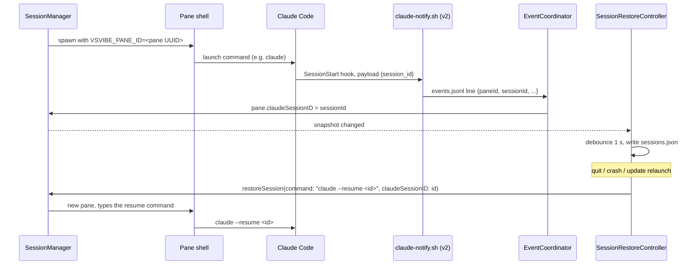

# Session restore

VSVibe reopens the panes that were open when it last quit, crashed or relaunched
to install an update. A pane that was running Claude Code continues **its own**
conversation (`claude --resume <id>`), even when several panes share one
project folder.

Code: `VSVibe/Restore/`, plus the pane-id plumbing in `VSVibe/Terminal/`,
`VSVibe/Store/SessionManager.swift` and `VSVibe/Notifications/`.

## What the user sees

- **Settings → General → "Restore sessions on launch"** — on by default.
  UserDefaults key `restoreSessionsOnLaunch` (`SessionRestoreSettings.key`,
  default `SessionRestoreSettings.defaultValue = true`). The tab binds it with
  `@AppStorage`; the rest of the app reads it through `SessionRestoreSettings`.
- On launch, the panes come back in the same order (the tiling layout is
  derived from that order) and the previously focused pane is focused again.
- Claude panes resume their conversation; other panes rerun their project's
  launch command. Scrollback is not restored.
- With the setting off, nothing is reopened and `sessions.json` is deleted on
  the next save. Installing an update then asks before relaunching if panes are
  running (see [auto-update-and-releases.md](auto-update-and-releases.md)).

## When state is saved

`SessionRestoreController` (created in `AppEnvironment`, started from
`startEventStream()`) saves:

- **On every change**, debounced by 1 s (`Constants.saveDelay`). It observes
  `SessionManager.snapshot` with `withObservationTracking` and re-arms after
  each change. Changes that trigger a save: panes opened/closed/reordered, a
  pane's `claudeSessionID` changing, focus changing. A crash loses at most the
  last debounce interval.
- **On quit**, synchronously from `NSApplication.willTerminateNotification`.
- Once right after `start()`, so the file reflects the restored state.

`start()` runs only once per process and is skipped entirely inside the unit-test
host (`isUnitTestHost`, keyed on `XCTestConfigurationFilePath`), so tests never
spawn the user's panes or overwrite their file.

## `sessions.json`

Location: `~/Library/Application Support/VSVibe/sessions.json`
(`AppPaths.sessionsFile`). Written atomically, pretty-printed with sorted keys
(`SessionSnapshotFile`).

```json
{
  "focusedIndex" : 1,
  "panes" : [
    { "claudeSessionID" : "0b9d…-uuid", "folderID" : "6F1C…-uuid" },
    { "folderID" : "6F1C…-uuid" }
  ],
  "version" : 1
}
```

| Field | Meaning |
| --- | --- |
| `version` | `SessionSnapshot.currentVersion` (currently `1`). |
| `panes[]` | `PaneSnapshot` in display order. |
| `panes[].folderID` | `FolderEntry.id` of the pane's project (from `state.json`). |
| `panes[].claudeSessionID` | Claude `session_id` last seen in that pane; omitted when unknown. |
| `focusedIndex` | Index into `panes` of the focused pane; omitted when none. |

Version handling: the version is written but not checked on read. Decoding
uses the normal `Codable` rules (unknown keys ignored, missing required keys
fail). A missing, unreadable or undecodable file is logged and treated as
"nothing to restore"; it never blocks launch.

What is **not** saved: scrollback, shell state, working directory changes,
per-pane command overrides (a restored pane uses the project's *current*
launch command).

## Linking a pane to its Claude conversation



1. **Pane id in the environment.** `EnvBuilder.build(paneID:)` exports
   `VSVIBE_PANE_ID=<TerminalSession.id>` (`EnvBuilder.paneIDKey`) to each
   pane's shell; without a pane id any inherited value is removed. Anything the
   shell starts, including Claude and its hooks, inherits it.
2. **Hook script v2.** `HookInstaller` writes `HookScript.contents` to
   `~/.vsvibe/hooks/claude-notify.sh` and registers it in each hook-capable
   alias's `settings.json` for `SessionStart`, `Stop` and `Notification`
   (`HookInstaller.installedEvents`; `SubagentStop` is only recognised for
   cleanup). The script appends one JSON line per event to
   `~/.vsvibe/events.jsonl` with `event`, `projectDir`, `ts`, `message` and,
   new in v2, `paneId` (from `VSVIBE_PANE_ID`) and `sessionId` (the payload's
   `session_id`, parsed with `python3` when available, otherwise empty).
3. **`SessionStart`** fires when Claude starts, resumes or after `/clear`, so
   the pane learns its conversation id before the first turn finishes.
4. **Capture and validation.** `HookEvent` decodes `paneId` as a UUID and
   `sessionId` (falling back to a nested `payload.session_id`), treating empty
   strings as absent. `EventCoordinator.recordClaudeSessionID` stores the id on
   the pane only when the event's `paneId` equals that pane's id **and**
   `LaunchCommandResolver.isValidClaudeSessionID` accepts it: non-empty, at
   most 128 characters, only `[A-Za-z0-9_-]`. This keeps the id safe to type
   into a shell later. A folder-only match never sets an id (ambiguous with
   several panes per folder).
5. **Event → pane routing** (`EventCoordinator.matchSession`): first the open
   pane whose id equals `paneId`; otherwise the first pane whose folder equals
   `projectDir` (standardised, symlinks resolved), which covers v1 scripts and
   Claude runs outside VSVibe. `SessionStart` only records the id: no badge,
   stats entry or notification. Other events with no matching pane are recorded
   in stats by `projectDir` and posted as a generic notification.

## Restore algorithm

`SessionRestoreController.restore()` reads the snapshot, builds a
`SessionRestorePlan` with `SessionRestorePlan.make(snapshot:folders:aliasLookup:)`
and opens each planned pane with `SessionManager.restoreSession(for:command:claudeSessionID:)`.

For each saved pane, in order:

1. **Project lookup.** If `folderID` no longer matches a project in
   `FolderStore`, the pane is skipped. If it was the focused pane, focus is
   dropped.
2. **Level 2 — resume the conversation**, when all hold:
   - `claudeSessionID` is present and passes `isValidClaudeSessionID`;
   - the project's launch command is non-empty;
   - the command's base token (`LaunchCommandResolver.baseCommand`) is not a
     known alias without Claude hooks. `aliasLookup` is
     `LaunchAliasStore.alias(for:)`; an alias with no `claudeConfigDir`
     (`supportsClaudeHooks == false`) is excluded. Built-ins excluded:
     **`opencode`** and **`codex`**. Unknown commands are allowed, since they
     may wrap Claude.

   The command is `LaunchCommandResolver.resumeCommand(for:claudeSessionID:)`:
   tokens `--continue`, `-c`, `--resume=<x>` are removed, `--resume`/`-r` are
   removed together with their value (unless the next token starts with `-`),
   then `--resume <id>` is appended. Example:
   `claude --model opus -c` → `claude --model opus --resume <id>`.
3. **Level 1 — fallback**: the project's plain launch command, and the pane
   starts with no `claudeSessionID`. This applies when the id is missing
   (hooks missing or v1, Claude never started, `python3` absent) or invalid, or
   the command is excluded as above.

**Focus.** `focusedIndex` is remapped to the position in the filtered plan.
`SessionManager.makeSession` focuses the first pane created when nothing is
focused; the controller then explicitly focuses the planned pane, if any.

**Second relaunch.** `restoreSession` sets the new pane's `claudeSessionID` to
the resumed id immediately, so it is written to `sessions.json` again even if
Claude has not fired a hook yet in the new pane. A later `SessionStart` from
`claude --resume` (carrying the new `VSVIBE_PANE_ID`) replaces it if Claude
reports a different id.

## Upgrade step for existing users

Hook script v1 does not emit `paneId`/`sessionId` and does not register
`SessionStart`. After upgrading VSVibe:

1. Open **Aliases & Claude Hooks…** and click **Update Hooks**. The button is
   titled that way when `HookInstaller.Status.needsUpdate` is true: the
   installed script differs from `HookScript.contents`, or an alias has some
   but not all of `installedEvents`. Installing backs up each `settings.json`
   to `settings.json.vsvibe.bak`.
2. **Restart Claude sessions that were already running.** They keep the old
   hook registration and were started from shells without `VSVIBE_PANE_ID`
   (panes opened by an older VSVibe), so they fall back to level 1 on the next
   launch.

## Known limitations

- Scrollback, shell history and anything typed but not run are lost.
- Without `python3` on the hook's `PATH`, `sessionId` is empty: level 1 only.
- Only aliases that support Claude hooks report ids; panes running other tools
  always restart their launch command.
- `-r`/`--resume` stripping is token-based (split on spaces); quoted arguments
  containing spaces are not understood.
- A command whose base token is unknown gets `--resume <id>` appended (only if
  a valid id was ever reported for that pane, which requires the VSVibe hook to
  have run inside it).
- The snapshot `version` is not checked on read (see above).
- The snapshot is per app install; nothing syncs between Macs.

## Tests

All in `VSVibeTests/`:

| Area | Test file |
| --- | --- |
| Plan (level 1/2, skipped panes, focus, aliases) | `SessionRestorePlanTests.swift` |
| Controller (save, debounce, terminate, disabled) | `SessionRestoreControllerTests.swift` |
| `sessions.json` read/write/remove | `SessionSnapshotFileTests.swift` |
| Setting and `sessionsLostOnRelaunch` | `SessionRestoreSettingsTests.swift` |
| `SessionManager.snapshot` / `restoreSession` | `SessionManagerRestoreTests.swift` |
| Pane-id routing and id capture | `EventCoordinatorPaneTests.swift`, `EventCoordinatorTests.swift` |
| Event decoding (`paneId`, `sessionId`) | `HookEventTests.swift` |
| Script contents/version, installer, update detection | `HookScriptTests.swift`, `HookInstallerTests.swift`, `HookInstallerUpdateTests.swift` |
| `resumeCommand`, id validation | `LaunchCommandResolverTests.swift` |
| `VSVIBE_PANE_ID` export | `EnvBuilderTests.swift` |
