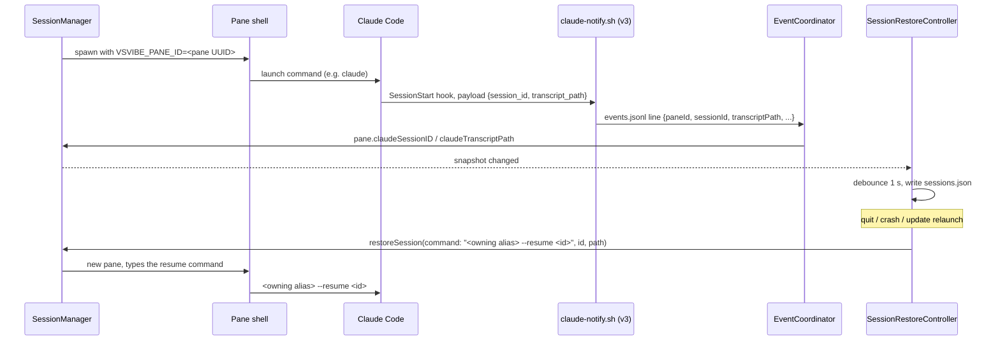

# Session restore

VSVibe reopens the panes that were open when it last quit, crashed or relaunched
to install an update. A pane that was running Claude Code continues **its own**
conversation (`claude --resume <id>`), even when several panes share one
project folder, and resumes it with the alias (Claude config dir / account) that
actually ran it.

Code: `VSVibe/Restore/`, plus the pane-id plumbing in `VSVibe/Terminal/`,
`VSVibe/Store/SessionManager.swift` and `VSVibe/Notifications/`.

## What the user sees

- **Settings → General → "Restore sessions on launch"** — on by default.
  UserDefaults key `restoreSessionsOnLaunch` (`SessionRestoreSettings.key`,
  default `SessionRestoreSettings.defaultValue = true`). The tab binds it with
  `@AppStorage`; the rest of the app reads it through `SessionRestoreSettings`.
- On launch, the panes come back in the same order (the tiling layout is
  derived from that order) and the previously focused pane is focused again.
- Claude panes resume their conversation with the alias that owns it; other
  panes rerun their project's launch command. Scrollback is not restored.
- With the setting off, nothing is reopened and `sessions.json` is deleted on
  the next save. Installing an update then asks before relaunching if panes are
  running (see [auto-update-and-releases.md](auto-update-and-releases.md)).

## When state is saved

`SessionRestoreController` (created in `AppEnvironment`, started from
`startEventStream()`) saves:

- **On every change**, debounced by 1 s (`Constants.saveDelay`). It observes
  `SessionManager.snapshot` with `withObservationTracking` and re-arms after
  each change. Changes that trigger a save: panes opened/closed/reordered, a
  pane's `claudeSessionID` changing, focus changing. A crash loses at most the
  last debounce interval. (`claudeTranscriptPath` changes together with the
  session id.)
- **On quit**, synchronously from `NSApplication.willTerminateNotification`.
- Once right after `start()`, so the file reflects the restored state.

`start()` runs only once per process and is skipped entirely inside the unit-test
host (`isUnitTestHost`, keyed on `XCTestConfigurationFilePath`), so tests never
spawn the user's panes or overwrite their file.

## `sessions.json`

Location: `~/Library/Application Support/VSVibe/sessions.json`
(`AppPaths.sessionsFile`). Written atomically, pretty-printed with sorted keys
(`SessionSnapshotFile`).

```json
{
  "focusedIndex" : 1,
  "panes" : [
    {
      "claudeSessionID" : "0b9d…-uuid",
      "folderID" : "6F1C…-uuid",
      "transcriptPath" : "/Users/me/.claude-work/projects/-Users-me-app/0b9d…-uuid.jsonl"
    },
    { "folderID" : "6F1C…-uuid" }
  ],
  "version" : 2
}
```

| Field | Meaning |
| --- | --- |
| `version` | `SessionSnapshot.currentVersion` (currently `2`). |
| `panes[]` | `PaneSnapshot` in display order. |
| `panes[].folderID` | `FolderEntry.id` of the pane's project (from `state.json`). |
| `panes[].claudeSessionID` | Claude `session_id` last seen in that pane; omitted when unknown. |
| `panes[].transcriptPath` | v2: Claude `transcript_path` of that conversation; omitted when unknown. |
| `focusedIndex` | Index into `panes` of the focused pane; omitted when none. |

Versions: v1 has no `transcriptPath`; v2 adds it. `SessionSnapshotFile.read`
first decodes only `version`: a file with a version newer than
`currentVersion` (written by a newer VSVibe) is logged and not restored, and a
file without `version` does not decode. v1 files load normally (their panes
simply have no transcript path) and are rewritten as v2 on the next save.
Otherwise decoding uses the normal `Codable` rules (unknown keys ignored,
missing required keys fail). A missing, unreadable, undecodable or too-new file
is logged and treated as "nothing to restore"; it never blocks launch.

What is **not** saved: scrollback, shell state, working directory changes,
per-pane command overrides (a restored pane uses the project's *current*
launch command).

## Linking a pane to its Claude conversation



1. **Pane id in the environment.** `EnvBuilder.build(paneID:)` exports
   `VSVIBE_PANE_ID=<TerminalSession.id>` (`EnvBuilder.paneIDKey`) to each
   pane's shell; without a pane id any inherited value is removed. Anything the
   shell starts, including Claude and its hooks, inherits it.
2. **Hook script v3.** `HookInstaller` writes `HookScript.contents` to
   `~/.vsvibe/hooks/claude-notify.sh` and registers it in each hook-capable
   alias's `settings.json` for `SessionStart`, `Stop` and `Notification`
   (`HookInstaller.installedEvents`; `SubagentStop` is only recognised for
   cleanup). The script appends one JSON line per event to
   `~/.vsvibe/events.jsonl` with `event`, `projectDir`, `ts`, `message`,
   since v2 `paneId` (from `VSVIBE_PANE_ID`) and `sessionId` (the payload's
   `session_id`) and, new in v3, `transcriptPath` (the payload's
   `transcript_path`). Payload fields are parsed with `python3` when available,
   otherwise empty. The script prints nothing to stdout (`SessionStart` output
   would be added to Claude's context).
3. **`SessionStart`** fires when Claude starts, resumes or after `/clear`, so
   the pane learns its conversation id before the first turn finishes.
4. **Capture and validation.** `HookEvent` decodes `paneId` as a UUID,
   `sessionId` and `transcriptPath` (falling back to a nested
   `payload.session_id` / `payload.transcript_path`), treating empty strings
   as absent. `EventCoordinator.recordClaudeSessionID` stores the id on the
   pane only when the event's `paneId` equals that pane's id **and**
   `LaunchCommandResolver.isValidClaudeSessionID` accepts it: non-empty, at
   most 128 characters, only `[A-Za-z0-9_-]`. This keeps the id safe to type
   into a shell later. Along with it, `claudeTranscriptPath` is set to the
   event's `transcriptPath` if `ClaudeTranscriptPath.validated` accepts it
   (absolute, no control characters, ending in `/<session_id>.jsonl`), and
   cleared otherwise, so a path never outlives its conversation. A folder-only
   match never sets an id or path (ambiguous with several panes per folder).
5. **Event → pane routing** (`EventCoordinator.matchSession`): first the open
   pane whose id equals `paneId`; otherwise the first pane whose folder equals
   `projectDir` (standardised, symlinks resolved), which covers v1 scripts and
   Claude runs outside VSVibe. `SessionStart` only records the id: no badge,
   stats entry or notification. Other events with no matching pane are recorded
   in stats by `projectDir` and posted as a generic notification.

## Restore algorithm

`SessionRestoreController.restore()` reads the snapshot, builds a
`SessionRestorePlan` with `SessionRestorePlan.make(snapshot:folders:lookups:)`
and opens each planned pane with
`SessionManager.restoreSession(for:command:claudeSessionID:transcriptPath:)`.

The plan is pure: everything it asks the outside world goes through
`SessionRestorePlan.Lookups`, which `AppEnvironment` wires to the app:

| Lookup | Live implementation |
| --- | --- |
| `aliasForCommand` | `LaunchAliasStore.alias(for:)` (matches the base command) |
| `aliasForConfigDir` | `LaunchAliasStore.alias(forConfigDir:)` |
| `fileExists` | `FileManager.default.fileExists(atPath:)` |

For each saved pane, in order:

1. **Project lookup.** If `folderID` no longer matches a project in
   `FolderStore`, the pane is skipped. If it was the focused pane, focus is
   dropped.
2. **Conversation id.** Without a `claudeSessionID` that passes
   `isValidClaudeSessionID`, the pane gets level 1 (below).
3. **Command selection** (`SessionRestorePlan.Resolution`, logged by the
   controller for the non-routine cases):

   | Saved state | Command typed | Carried id / path | `Resolution` |
   | --- | --- | --- | --- |
   | no valid id | project command | none | `launchCommand` |
   | id, no (valid) transcript path: v1 file, hooks < v3 | project command `--resume <id>` (level 1 if the command can't resume, see below) | id | `resumedWithProjectCommand` (else `launchCommand`) |
   | id + path, **file missing** | project command, **no `--resume`** | none | `transcriptMissing` (logged) |
   | id + path, an alias owns the config dir, project command runs that alias | project command (its flags kept) `--resume <id>` | id + path | `resumedWithOwningAlias` (logged) |
   | id + path, an alias owns the config dir, project command runs something else | `<alias command> --resume <id>` | id + path | `resumedWithOwningAlias` (logged) |
   | id + path, no alias owns the config dir | project command `--resume <id>` (best effort; level 1 if it can't resume) | id + path | `resumedWithUnknownConfigDir` (logged; else `launchCommand`) |

   - **Config dir of a transcript** (`ClaudeTranscriptPath.configDir`): the
     path is `<config dir>/projects/<slug>/<id>.jsonl`, so the config dir is
     the nearest ancestor holding the `projects` directory on the path; none
     when no ancestor is named `projects`.
   - **Owning alias** (`LaunchAliasStore.alias(forConfigDir:)`): the first
     alias (built-ins, then custom) whose `claudeConfigDir` equals it after
     `ClaudeTranscriptPath.canonical` on both sides: `~` expanded,
     standardized (`.`/`..` removed), symlinks resolved. The built-in
     **`claude`** alias owns `~/.claude` (VSVibe models the default config dir
     that way; a `CLAUDE_CONFIG_DIR` exported in the shell is not read, so a
     conversation under such a dir only matches if an alias is registered for
     it).
   - **Same alias** means the project command's base token
     (`LaunchCommandResolver.baseCommand`) equals the alias command; the
     project's flags (e.g. `--model opus`) are then kept.
   - **Can the project command resume?** It must be non-empty and its base
     token must not be a known alias without Claude hooks
     (`supportsClaudeHooks == false`; built-ins **`opencode`**, **`codex`**).
     Unknown commands are allowed, since they may wrap Claude. An owning alias
     always resumes, even in a project whose command is `codex` or empty: the
     conversation is known to belong to that Claude alias.
   - **`--resume` construction** is
     `LaunchCommandResolver.resumeCommand(for:claudeSessionID:)`: tokens
     `--continue`, `-c`, `--resume=<x>` are removed, `--resume`/`-r` are
     removed together with their value (unless the next token starts with
     `-`), then `--resume <id>` is appended. Example:
     `claude --model opus -c` → `claude --model opus --resume <id>`.
4. **Level 1 — fallback**: the project's plain launch command, and the pane
   starts with no `claudeSessionID` (or path). This applies when the id is
   missing (hooks missing or v1, Claude never started, `python3` absent) or
   invalid, when the transcript file is gone (Claude would report the
   conversation as not found), or when the project command can't resume and
   no owning alias was found.

**Focus.** `focusedIndex` is remapped to the position in the filtered plan.
`SessionManager.makeSession` focuses the first pane created when nothing is
focused; the controller then explicitly focuses the planned pane, if any.

**Second relaunch.** `restoreSession` sets the new pane's `claudeSessionID`
and `claudeTranscriptPath` to the resumed ones immediately, so they are written
to `sessions.json` again even if Claude has not fired a hook yet in the new
pane. A later `SessionStart` from `claude --resume` (carrying the new
`VSVIBE_PANE_ID`) replaces them if Claude reports a different id or path.

## Upgrade step for existing users

Hook script v1 does not emit `paneId`/`sessionId` and does not register
`SessionStart`; v2 does not emit `transcriptPath`, so its conversations are
resumed with the project's command, not their owning alias. After upgrading
VSVibe (including from a build with the v2 script):

1. Open **Aliases & Claude Hooks…** and click **Update Hooks**. The button is
   titled that way when `HookInstaller.Status.needsUpdate` is true: the
   installed script differs from `HookScript.contents`, or an alias has some
   but not all of `installedEvents`. Installing backs up each `settings.json`
   to `settings.json.vsvibe.bak`.
2. **Restart Claude sessions that were already running.** They keep the old
   hook registration and were started from shells without `VSVIBE_PANE_ID`
   (panes opened by an older VSVibe), so they fall back to level 1 on the next
   launch. Conversations already recorded without a transcript path keep
   today's behaviour (project command + `--resume`) until their pane reports
   one: the next `Stop`/`Notification`/`SessionStart` from a v3 script fills
   it in.

## Known limitations

- Scrollback, shell history and anything typed but not run are lost.
- Without `python3` on the hook's `PATH`, `sessionId` is empty: level 1 only.
- Without `python3`, `transcriptPath` is empty too, so the owning alias can't
  be chosen.
- Only aliases that support Claude hooks report ids; panes running other tools
  always restart their launch command.
- The owning alias is found only if it is registered in VSVibe with that
  config dir. A conversation run by an unregistered command (or a shell
  `CLAUDE_CONFIG_DIR` other than an alias's) resumes with the project command,
  which may fail to find it.
- When the owning alias differs from the project's command, only the alias's
  bare command is used: the project's extra flags belong to another command
  and are dropped.
- The transcript-file check runs once, at launch. If Claude has moved or
  deleted the file, the pane starts fresh instead of resuming.
- `-r`/`--resume` stripping is token-based (split on spaces); quoted arguments
  containing spaces are not understood.
- A command whose base token is unknown gets `--resume <id>` appended (only if
  a valid id was ever reported for that pane, which requires the VSVibe hook to
  have run inside it).
- A snapshot written by a newer VSVibe is ignored rather than partially
  restored (see above).
- The snapshot is per app install; nothing syncs between Macs.

## Tests

All in `VSVibeTests/`:

| Area | Test file |
| --- | --- |
| Plan (level 1/2, owning alias, missing transcript, skipped panes, focus) | `SessionRestorePlanTests.swift` |
| Transcript path validation, config dir, alias by config dir (tilde/symlink) | `ClaudeTranscriptPathTests.swift` |
| Controller (restore with transcripts, save, debounce, terminate, disabled) | `SessionRestoreControllerTests.swift` |
| `sessions.json` read/write/remove, v1 load, newer version rejected | `SessionSnapshotFileTests.swift` |
| Setting and `sessionsLostOnRelaunch` | `SessionRestoreSettingsTests.swift` |
| `SessionManager.snapshot` / `restoreSession` | `SessionManagerRestoreTests.swift` |
| Pane-id routing, id and transcript-path capture | `EventCoordinatorPaneTests.swift`, `EventCoordinatorTests.swift` |
| Event decoding (`paneId`, `sessionId`, `transcriptPath`) | `HookEventTests.swift` |
| Script contents/version, installer, update detection | `HookScriptTests.swift`, `HookInstallerTests.swift`, `HookInstallerUpdateTests.swift` |
| `resumeCommand`, id validation, alias by base command | `LaunchCommandResolverTests.swift` |
| `VSVIBE_PANE_ID` export | `EnvBuilderTests.swift` |
